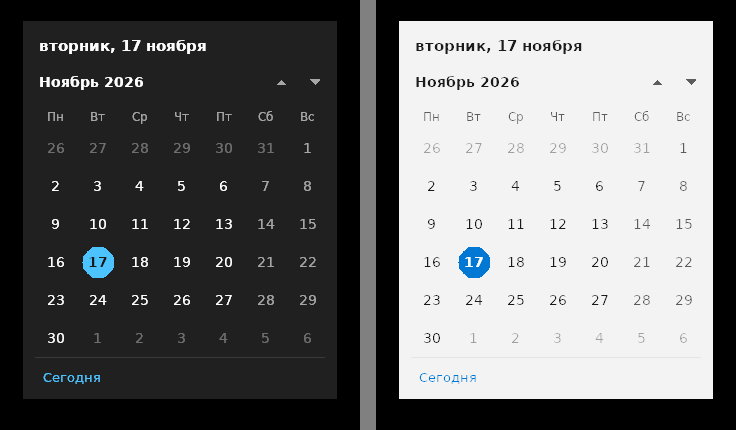

# Dock Calendar — всплывающий календарь у кнопки панели

Небольшое нативное приложение (**Win32 + GDI+**, ~245 КБ, **без .NET и без
Visual C++ Runtime**), которое решает проблему панелей вроде **PowerToys Dock**:
клик по виджету часов/даты открывает системную панель уведомлений *сбоку*.
Это приложение вместо неё показывает **календарь прямо под кнопкой, на которую
вы нажали** — как всплывающее окно, а не боковую панель.

Поддерживает **Windows 10 и Windows 11**, x64. **Светлая и тёмная тема** в стиле
Windows 11 — выбирается **автоматически вслед за системной** и переключается на
лету, без перезапуска. Скруглённые углы и тень на Windows 11, корректная работа с
масштабом (DPI) и несколькими мониторами. Язык и первый день недели берутся из
локали пользователя (русский, английский и др.).




---

## Как подключить к панели (PowerToys Dock и т.п.)

1. Положите `DockCalendar.exe` в постоянную папку, например
   `C:\Tools\DockCalendar\DockCalendar.exe` (не запускайте прямо из архива/загрузок).
2. В панели прикрепите этот файл как значок **`.exe`** (или создайте `.lnk` на
   него и прикрепите ярлык). Иконка календаря уже «вшита» в exe.
3. **Клик по кнопке** → календарь появляется **рядом с курсором, под панелью**
   (по центру кнопки). Если снизу не хватает места — окно появится над курсором.
4. **Повторный клик по той же кнопке** → календарь закрывается (как системные
   часы Windows).
5. **Клик мимо окна** или **Esc** → окно скрывается.

> После первого запуска процесс остаётся работать в фоне (иконка в системном
> трее), поэтому каждый следующий клик открывает/закрывает календарь **мгновенно**,
> без задержки на запуск. Полностью закрыть программу: правый клик по иконке в
> трее → **«Выход»** (или `DockCalendar.exe /exit`).

---

## Управление календарём

| Действие | Результат |
|---|---|
| Стрелки **▲ / ▼** справа в заголовке | листать месяц / год / десятилетие (в зависимости от вида) |
| **Колесо мыши** | то же — листать периоды |
| Клик по заголовку **«Ноябрь 2026»** | перейти к виду **года** |
| Клик по заголовку **«2026»** | перейти к виду **десятилетия** |
| Клик по месяцу в виде года | вернуться к этому месяцу |
| Клик по году в виде десятилетия | перейти к этому году |
| Клик по дню (в т.ч. серому соседнего месяца) | выбрать день; соседний месяц — перейти к нему |
| Кнопка **«Сегодня»** | вернуться к текущему месяцу и сегодняшнему дню |

**Клавиатура:** `Esc` — закрыть; `← → ↑ ↓` — выбрать день (в виде месяца) или
листать период; `PgUp / PgDn` — листать период; `Home` — сегодня; `Enter` —
подняться на уровень выше (месяц → год → десятилетие).

Сегодняшний день выделен цветным кружком, выбранный — кольцом, выходные и дни
соседнего месяца приглушены.

---

## Тема оформления (светлая / тёмная)

Приложение **само следует теме системы** — ничего настраивать не нужно:

- Тема читается из реестра:
  `HKCU\Software\Microsoft\Windows\CurrentVersion\Themes\Personalize` →
  `AppsUseLightTheme` (`1` = светлая, `0` = тёмная). Это тот самый переключатель
  **Параметры → Персонализация → Цвета → Выбор режима**.
- При смене темы система рассылает сообщение `WM_SETTINGCHANGE`
  (`ImmersiveColorSet`) — открытое окно **перекрашивается сразу**, без закрытия.
  Если тема сменилась, пока календарь был скрыт, она применится при следующем
  открытии.
- Светлая палитра: фон `#F3F3F3`, текст `#1B1B1B`, акцент `#0078D4` (белый текст
  на кружке «сегодня»). Тёмная: фон `#202020`, текст `#FFFFFF`, акцент `#4CC2FF`.
  На Windows 11 рамка DWM тоже переводится в соответствующий режим.

---

## Ключи запуска (необязательные)

| Ключ | Назначение |
|---|---|
| `/exit` | завершить уже работающий экземпляр |
| `/noautohide` | не скрывать окно при потере фокуса (отладка) |
| `/at=X,Y` | показать окно в заданной точке экрана (отладка) |

---

## Сборка из исходников

Готовый exe уже лежит рядом. Если нужно пересобрать:

**Windows (MinGW-w64 в `PATH`, например MSYS2 / winlibs):**
```bat
cd src
build.bat
```

**Linux (кросс-компиляция, пакет `g++-mingw-w64-x86-64`):**
```sh
cd src
./build.sh
```

Иконка (`app.ico`) уже включена в `src`. При желании её можно перегенерировать:
`python3 make_icon.py` (нужен Pillow).

### Состав исходников
- `main.cpp` — всё приложение (окно, отрисовка GDI+, навигация, локаль, тема
  системы, трей, единственный экземпляр, позиционирование у курсора, DPI).
- `resource.rc` / `app.manifest` / `app.ico` — иконка, версия, манифест
  (DPI Per-Monitor V2, уровень `asInvoker`).

### Как это работает (кратко)
- Окно — `WS_POPUP` без рамки, поверх всех (`WS_EX_TOPMOST`), не показывается в
  Alt-Tab и на панели задач (`WS_EX_TOOLWINDOW`). Тень даёт DWM.
- При показе берётся позиция курсора (`GetCursorPos`) и монитор под ним
  (`MonitorFromPoint`); окно центрируется по горизонтали кнопки и ставится чуть
  ниже курсора, с зажимом в границы экрана.
- Единственный экземпляр через именованный мьютекс: повторный запуск находит
  окно первого и шлёт ему сообщение «переключить» (открыть/закрыть).
- Тема — из `AppsUseLightTheme` (реестр), живое обновление по `WM_SETTINGCHANGE`
  (`ImmersiveColorSet`); палитры светлая/тёмная в `SetPalette()`.
- Арифметика дат — через порядковый день (алгоритм Ховарда Хиннанта), без
  переполнений `SYSTEMTIME`; имена месяцев/дней — из `GetLocaleInfoEx`, порядок
  дней недели самовыравнивается под локаль.

---

## Если что-то не так

- **Окно не у кнопки, а в углу экрана** — панель запустила exe без передачи
  позиции курсора; приложение ориентируется на реальное положение курсора в
  момент клика. Убедитесь, что кликаете именно по значку (курсор над кнопкой).
- **Антивирус/SmartScreen ругается на неподписанный exe** — это нормально для
  самосборного файла без цифровой подписи: «Подробнее» → «Выполнить в любом
  случае», либо добавьте папку в исключения.
- **Хочется другой акцент / оттенки** — обе палитры (светлая и тёмная) заданы в
  функции `SetPalette()` в `main.cpp`, пересоберите под себя. Принудительно
  зафиксировать одну тему можно, заменив вызов `SetPalette(SystemIsLight())` на
  `SetPalette(true)` (светлая) или `SetPalette(false)` (тёмная).
