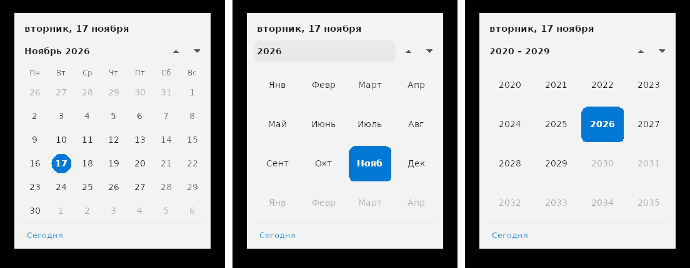

**[EN]**
---
# Dock Calendar — a pop-up calendar next to a taskbar button

A small native application (**Win32 + GDI+**, ~245 KB, **no .NET and no
Visual C++ Runtime**) that solves the problem of docks like **PowerToys Dock**:
clicking the clock/date widget opens the system notification panel *on the side*.
This app instead shows a **calendar right under the button you clicked** — as a
pop-up window, not a side panel.

Supports **Windows 10 and Windows 11**, x64. **Light and dark themes** in the
Windows 11 style — selected **automatically following the system** and switched on
the fly, without a restart. Rounded corners and shadow on Windows 11, correct
handling of scaling (DPI) and multiple monitors. The language and first day of the
week are taken from the user's locale (Russian, English, etc.).




---

## How to attach it to a dock (PowerToys Dock, etc.)

1. Put `DockCalendar.exe` in a permanent folder, e.g.
   `C:\Tools\DockCalendar\DockCalendar.exe` (don't run it straight from an archive/downloads).
2. In the dock, pin this file as an **`.exe`** icon (or create a `.lnk` to
   it and pin the shortcut). The calendar icon is already "baked" into the exe.
3. **Click the button** → the calendar appears **next to the cursor, under the dock**
   (centered on the button). If there isn't enough room below — the window appears above the cursor.
4. **Click the same button again** → the calendar closes (like the system
   clock in Windows).
5. **Click outside the window** or **Esc** → the window hides.

> After the first launch, the process keeps running in the background (an icon in the system
> tray), so every subsequent click opens/closes the calendar **instantly**,
> with no startup delay. To fully close the program: right-click the tray icon →
> **"Exit"** (or `DockCalendar.exe /exit`).

---

## Calendar controls

| Action | Result |
|---|---|
| **▲ / ▼** arrows on the right of the header | page through month / year / decade (depending on the view) |
| **Mouse wheel** | same — page through periods |
| Click the **"November 2026"** header | go to the **year** view |
| Click the **"2026"** header | go to the **decade** view |
| Click a month in the year view | return to that month |
| Click a year in the decade view | go to that year |
| Click a day (including a gray one from the adjacent month) | select the day; an adjacent month — go to it |
| **"Today"** button | return to the current month and today's day |

**Keyboard:** `Esc` — close; `← → ↑ ↓` — select a day (in the month view) or
page through periods; `PgUp / PgDn` — page through periods; `Home` — today; `Enter` —
go up one level (month → year → decade).

Today's day is highlighted with a colored circle, the selected one — with a ring, weekends and days
of the adjacent month are dimmed.

---

## Theme (light / dark)

The app **follows the system theme automatically** — nothing to configure:

- The theme is read from the registry:
  `HKCU\Software\Microsoft\Windows\CurrentVersion\Themes\Personalize` →
  `AppsUseLightTheme` (`1` = light, `0` = dark). This is the very switch in
  **Settings → Personalization → Colors → Choose your mode**.
- When the theme changes, the system broadcasts a `WM_SETTINGCHANGE`
  (`ImmersiveColorSet`) message — the open window **recolors immediately**, without closing.
  If the theme changed while the calendar was hidden, it will be applied the next time
  it is opened.
- Light palette: background `#F3F3F3`, text `#1B1B1B`, accent `#0078D4` (white text
  on the "today" circle). Dark: background `#202020`, text `#FFFFFF`, accent `#4CC2FF`.
  On Windows 11, the DWM frame is also switched to the corresponding mode.

---

## Launch options (optional)

| Option | Purpose |
|---|---|
| `/exit` | terminate an already running instance |
| `/noautohide` | don't hide the window on focus loss (debugging) |
| `/at=X,Y` | show the window at the specified screen point (debugging) |

---

## Building from source

The ready-made exe is already next to this file. If you need to rebuild:

**Windows (MinGW-w64 in `PATH`, e.g. MSYS2 / winlibs):**
```bat
cd src
build.bat
```
**Linux (cross-compilation, package `g++-mingw-w64-x86-64`):**

```sh
cd src
./build.sh
```
The icon (`app.ico`) is already included in src. If desired, it can be regenerated:
`python3 make_icon.py` (requires Pillow).

## Source files
`main.cpp` — the whole application (window, GDI+ rendering, navigation, locale, system
theme, tray, single instance, positioning at the cursor, DPI).

`resource.rc` / `app.manifest` / `app.ico` — icon, version, manifest
(DPI Per-Monitor V2, level `asInvoker`).

## How it works 
The window is `WS_POPUP` borderless, always on top (`WS_EX_TOPMOST`), not shown in
Alt-Tab or on the taskbar (`WS_EX_TOOLWINDOW`). The shadow is provided by DWM.

When shown, it takes the cursor position (`GetCursorPos`) and the monitor under it
(`MonitorFromPoint`); the window is centered horizontally on the button and placed slightly
below the cursor, clamped to the screen bounds.

Single instance via a named mutex: a repeated launch finds the first
window and sends it a "toggle" message (open/close).

Theme — from `AppsUseLightTheme` (registry), live update on `WM_SETTINGCHANGE`
(`ImmersiveColorSet`); light/dark palettes in `SetPalette()`.

Date arithmetic — via the ordinal day (Howard Hinnant's algorithm), without
`SYSTEMTIME` overflows; month/day names — from `GetLocaleInfoEx`, the order of
weekdays aligns itself to the locale.

## If something is wrong
**The window is not at the button but in a corner of the screen**
— the dock launched the exe without passing the cursor position; the app relies on the actual cursor position at the
moment of the click. Make sure you are clicking exactly on the icon (the cursor is over the button).

**Antivirus/SmartScreen complains about the unsigned exe**
— this is normal for a
self-built file without a digital signature: "More info" → "Run anyway",
or add the folder to exclusions.

**You want a different accent / shades —**
both palettes (light and dark) are defined in
the `SetPalette()` function in `main.cpp`, rebuild to your liking. To force
lock a single theme, replace the call `SetPalette(SystemIsLight())` with
`SetPalette(true)` (light) or `SetPalette(false)` (dark).


 ---

 
**[RU]**

# Dock Calendar — всплывающий календарь у кнопки панели

Небольшое нативное приложение (**Win32 + GDI+**, ~245 КБ, **без .NET и без
Visual C++ Runtime**), которое решает проблему панелей вроде **PowerToys Dock**:
клик по виджету часов/даты открывает системную панель уведомлений *сбоку*.
Это приложение вместо неё показывает **календарь прямо под кнопкой, на которую
вы нажали** — как всплывающее окно, а не боковую панель.

Поддерживает **Windows 10 и Windows 11**, x64. **Светлая и тёмная тема** в стиле
Windows 11 — выбирается **автоматически вслед за системной** и переключается на
лету, без перезапуска. Скруглённые углы и тень на Windows 11, корректная работа с
масштабом (DPI) и несколькими мониторами. Язык и первый день недели берутся из
локали пользователя (русский, английский и др.).


---

## Как подключить к панели (PowerToys Dock и т.п.)

1. Положите `DockCalendar.exe` в постоянную папку, например
   `C:\Tools\DockCalendar\DockCalendar.exe` (не запускайте прямо из архива/загрузок).
2. В панели прикрепите этот файл как значок **`.exe`** (или создайте `.lnk` на
   него и прикрепите ярлык). Иконка календаря уже «вшита» в exe.
3. **Клик по кнопке** → календарь появляется **рядом с курсором, под панелью**
   (по центру кнопки). Если снизу не хватает места — окно появится над курсором.
4. **Повторный клик по той же кнопке** → календарь закрывается (как системные
   часы Windows).
5. **Клик мимо окна** или **Esc** → окно скрывается.

> После первого запуска процесс остаётся работать в фоне (иконка в системном
> трее), поэтому каждый следующий клик открывает/закрывает календарь **мгновенно**,
> без задержки на запуск. Полностью закрыть программу: правый клик по иконке в
> трее → **«Выход»** (или `DockCalendar.exe /exit`).

---

## Управление календарём

| Действие | Результат |
|---|---|
| Стрелки **▲ / ▼** справа в заголовке | листать месяц / год / десятилетие (в зависимости от вида) |
| **Колесо мыши** | то же — листать периоды |
| Клик по заголовку **«Ноябрь 2026»** | перейти к виду **года** |
| Клик по заголовку **«2026»** | перейти к виду **десятилетия** |
| Клик по месяцу в виде года | вернуться к этому месяцу |
| Клик по году в виде десятилетия | перейти к этому году |
| Клик по дню (в т.ч. серому соседнего месяца) | выбрать день; соседний месяц — перейти к нему |
| Кнопка **«Сегодня»** | вернуться к текущему месяцу и сегодняшнему дню |

**Клавиатура:** `Esc` — закрыть; `← → ↑ ↓` — выбрать день (в виде месяца) или
листать период; `PgUp / PgDn` — листать период; `Home` — сегодня; `Enter` —
подняться на уровень выше (месяц → год → десятилетие).

Сегодняшний день выделен цветным кружком, выбранный — кольцом, выходные и дни
соседнего месяца приглушены.

---

## Тема оформления (светлая / тёмная)

Приложение **само следует теме системы** — ничего настраивать не нужно:

- Тема читается из реестра:
  `HKCU\Software\Microsoft\Windows\CurrentVersion\Themes\Personalize` →
  `AppsUseLightTheme` (`1` = светлая, `0` = тёмная). Это тот самый переключатель
  **Параметры → Персонализация → Цвета → Выбор режима**.
- При смене темы система рассылает сообщение `WM_SETTINGCHANGE`
  (`ImmersiveColorSet`) — открытое окно **перекрашивается сразу**, без закрытия.
  Если тема сменилась, пока календарь был скрыт, она применится при следующем
  открытии.
- Светлая палитра: фон `#F3F3F3`, текст `#1B1B1B`, акцент `#0078D4` (белый текст
  на кружке «сегодня»). Тёмная: фон `#202020`, текст `#FFFFFF`, акцент `#4CC2FF`.
  На Windows 11 рамка DWM тоже переводится в соответствующий режим.

---

## Ключи запуска (необязательные)

| Ключ | Назначение |
|---|---|
| `/exit` | завершить уже работающий экземпляр |
| `/noautohide` | не скрывать окно при потере фокуса (отладка) |
| `/at=X,Y` | показать окно в заданной точке экрана (отладка) |

---

## Сборка из исходников

Готовый exe уже лежит рядом. Если нужно пересобрать:

**Windows (MinGW-w64 в `PATH`, например MSYS2 / winlibs):**
```bat
cd src
build.bat
```

**Linux (кросс-компиляция, пакет `g++-mingw-w64-x86-64`):**
```sh
cd src
./build.sh
```

Иконка (`app.ico`) уже включена в `src`. При желании её можно перегенерировать:
`python3 make_icon.py` (нужен Pillow).

### Состав исходников
- `main.cpp` — всё приложение (окно, отрисовка GDI+, навигация, локаль, тема
  системы, трей, единственный экземпляр, позиционирование у курсора, DPI).
- `resource.rc` / `app.manifest` / `app.ico` — иконка, версия, манифест
  (DPI Per-Monitor V2, уровень `asInvoker`).

### Как это работает (кратко)
- Окно — `WS_POPUP` без рамки, поверх всех (`WS_EX_TOPMOST`), не показывается в
  Alt-Tab и на панели задач (`WS_EX_TOOLWINDOW`). Тень даёт DWM.
- При показе берётся позиция курсора (`GetCursorPos`) и монитор под ним
  (`MonitorFromPoint`); окно центрируется по горизонтали кнопки и ставится чуть
  ниже курсора, с зажимом в границы экрана.
- Единственный экземпляр через именованный мьютекс: повторный запуск находит
  окно первого и шлёт ему сообщение «переключить» (открыть/закрыть).
- Тема — из `AppsUseLightTheme` (реестр), живое обновление по `WM_SETTINGCHANGE`
  (`ImmersiveColorSet`); палитры светлая/тёмная в `SetPalette()`.
- Арифметика дат — через порядковый день (алгоритм Ховарда Хиннанта), без
  переполнений `SYSTEMTIME`; имена месяцев/дней — из `GetLocaleInfoEx`, порядок
  дней недели самовыравнивается под локаль.

---

## Если что-то не так

- **Окно не у кнопки, а в углу экрана** — панель запустила exe без передачи
  позиции курсора; приложение ориентируется на реальное положение курсора в
  момент клика. Убедитесь, что кликаете именно по значку (курсор над кнопкой).
- **Антивирус/SmartScreen ругается на неподписанный exe** — это нормально для
  самосборного файла без цифровой подписи: «Подробнее» → «Выполнить в любом
  случае», либо добавьте папку в исключения.
- **Хочется другой акцент / оттенки** — обе палитры (светлая и тёмная) заданы в
  функции `SetPalette()` в `main.cpp`, пересоберите под себя. Принудительно
  зафиксировать одну тему можно, заменив вызов `SetPalette(SystemIsLight())` на
  `SetPalette(true)` (светлая) или `SetPalette(false)` (тёмная).
